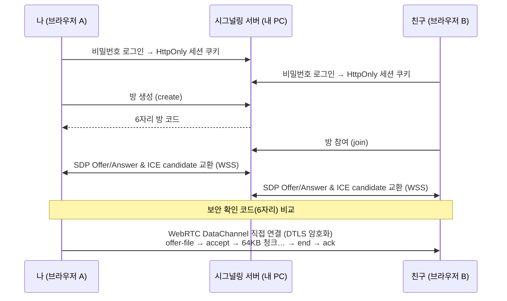

# 📡 P2P File Transfer

친구·가족 등 초대받은 사람끼리 **브라우저에서 직접(WebRTC DataChannel)** 파일을 주고받는 프라이빗 P2P 파일 전송 웹앱입니다.

파일 데이터는 서버를 절대 거치지 않습니다. 서버는 로그인한 사용자끼리 서로를 찾고 연결 정보(SDP / ICE candidate)만 중개(시그널링)합니다.

---

## 주요 기능

- **직접 P2P 전송 (WebRTC DataChannel)**: 서버 저장소나 업로드 트래픽 비용 없이 브라우저 간 직접 전송
- **대용량 파일 스트리밍**: 64KB 청크 + `bufferedAmountLowThreshold` 백프레셔 제어, Chrome/Edge에서는 File System Access API(`showSaveFilePicker`)로 메모리에 쌓지 않고 **디스크에 바로 저장**
- **수신 전 수락/거절**: 상대가 파일을 보내도 받는 쪽이 파일명·크기를 보고 **수락**해야 전송 시작
- **비밀번호 로그인 보호**: 공유 비밀번호(`APP_PASSWORD`) 없이는 앱 화면·설정·WebSocket 시그널링에 접근 불가
- **보안 확인 코드 (SAS, 6자리 숫자)**: 양쪽 WebRTC DTLS 인증서 지문으로 계산한 6자리 코드를 표시해, 시그널링 서버나 프록시의 중간자 공격(MITM) 여부를 확인 가능
- **연결 경로 표시**: 직접 연결(P2P)인지 TURN 중계인지 화면에 표시
- **최소 의존성**: 런타임 의존성은 [`ws`](https://github.com/websockets/ws) 하나뿐

---

## 동작 구조



---

## 보안 설계

외부 네트워크를 통해 친구와 쓸 때를 전제로 다음 보호 장치를 기본 적용했습니다.

| 영역 | 적용 내용 |
|---|---|
| **전송 암호화** | WebRTC DataChannel은 **DTLS 1.2/1.3으로 항상 종단간 암호화** (TURN 중계 시에도 중계 서버는 내용을 볼 수 없음) |
| **MITM 탐지** | 양쪽 DTLS 인증서 지문으로 **6자리 보안 확인 코드(SAS)** 생성 — 전화·메신저로 일치 여부 확인 |
| **접근 통제** | `APP_PASSWORD` 로그인 필수 (`timingSafeEqual` 비교, 5회 실패 시 15분 잠금, 지연 응답) |
| **세션 보호** | `HttpOnly`, `SameSite=Strict`, `Secure`(HTTPS) 쿠키, 만료 시 WebSocket 자동 종료 |
| **웹/WS 보호** | 정적 파일 화이트리스트, 엄격한 CSP, `Referrer-Policy: no-referrer`, `Origin` 검증(CSWSH 방지), 메시지 속도 제한 |
| **수신 파일 보호** | 수락 전 전송 차단, 파일명 경로/제어문자 제거, 폴백 Blob은 항상 `application/octet-stream` |
| **로컬 바인딩** | 기본 `HOST=127.0.0.1` — 공유기 포트포워딩 없이 터널/VPN 프록시로만 안전하게 노출 |

> **참고**: 시그널링 서버는 파일 내용을 볼 수 없지만, 연결 수립 시 브라우저 간 IP 정보(ICE candidate)와 방 코드를 중개합니다. 따라서 외부 접속 시에는 반드시 **HTTPS / WSS**를 사용하세요.

---

## 빠른 시작 (로컬 실행)

**요구사항**: Node.js 22.9 이상 (`--env-file-if-exists` 사용)

```bash
git clone <이-저장소-URL>
cd p2p-file-transfer
npm install
```

1. 환경 변수 파일을 만들고 비밀번호를 설정합니다.

```bash
# macOS / Linux
cp .env.example .env

# Windows (PowerShell)
Copy-Item .env.example .env
```

`.env` 파일을 열어 `APP_PASSWORD`를 8자 이상의 추측하기 어려운 값으로 채웁니다.
로컬 테스트(`http://localhost:3000`)만 먼저 해 볼 때는 `COOKIE_SECURE=0`으로 두세요.

```env
APP_PASSWORD=여기에-충분히-긴-비밀번호-입력
HOST=127.0.0.1
PORT=3000
COOKIE_SECURE=0
```

2. 서버를 실행합니다.

```bash
npm start
```

3. 브라우저 탭 두 개에서 `http://localhost:3000`에 접속해 로그인한 뒤, 한쪽에서 **새 방 만들기**, 다른 쪽에서 코드 입력으로 테스트합니다.

4. 테스트 실행:

```bash
npm test
```

---

## 외부에 공개하지 않고 친구와만 쓰기

서버가 기본으로 `127.0.0.1:3000`에서만 열리므로, 인터넷에 포트를 직접 열지 않고 아래 두 가지 방법 중 하나로 연결하는 것을 권장합니다.

### 방법 1. Tailscale Serve (가장 추천 · 프라이버시 최우선)

[Tailscale](https://tailscale.com)은 WireGuard 기반 개인 VPN입니다.
내 서버를 **내 Tailnet + 내가 초대(Share)한 친구 계정에게만** 노출하며, 외부 인터넷에서는 아예 접속할 수 없습니다.

1. 나와 친구 모두 Tailscale 설치 및 로그인
2. 내 PC에서 이 서버 실행 (`npm start`)
3. 내 PC에서 Tailscale Serve 실행 (자동으로 HTTPS 인증서 발급 + WebSocket 지원):
   ```bash
   tailscale serve --bg http://127.0.0.1:3000
   ```
4. 표시되는 `https://<내-PC>.<tailnet>.ts.net` 주소를 `.env`의 `ALLOWED_ORIGINS`에 넣고 `COOKIE_SECURE=1`, `TRUST_PROXY=1`로 설정 후 서버 재시작
5. Tailscale 관리 콘솔에서 내 기기를 **친구에게 공유(Share)**

- 장점: 검색 엔진·봇·외부 스캐너에 전혀 노출되지 않음, 자동 HTTPS, 종단간 VPN 암호화
- 단점: 친구도 Tailscale을 한 번 설치해야 함

### 방법 2. Cloudflare Tunnel + Cloudflare Access (친구 설치 불필요)

친구가 별도 프로그램을 설치하지 않고 브라우저만으로 들어오게 하려면 [Cloudflare Tunnel](https://developers.cloudflare.com/cloudflare-one/connections/connect-networks/)과 **Cloudflare Access**를 함께 씁니다.

1. Cloudflare Zero Trust에서 터널을 만들어 `http://127.0.0.1:3000` 연결
2. **Cloudflare Access** 정책에서 **내 이메일과 친구 이메일만 허용** (이메일 일회용 코드 또는 Google 로그인)
   - 이 설정이 없으면 도메인을 아는 누구나 로그인 화면에 닿을 수 있으니 Access를 꼭 함께 켜세요.
3. `.env`에 `ALLOWED_ORIGINS=https://내도메인`, `COOKIE_SECURE=1`, `TRUST_PROXY=1` 설정 후 서버 재시작

> 파일 데이터 자체는 WebRTC P2P로 직접 오가므로, Cloudflare 터널에는 가벼운 웹 페이지와 시그널링 트래픽만 통과합니다.

---

## 서로 다른 네트워크 간 연결이 실패할 때 (TURN 서버)

집/카페/LTE/회사 방화벽(대칭형 NAT) 조합에 따라 P2P 직접 홀펀칭이 실패할 수 있습니다.
이 경우 [coturn](https://github.com/coturn/coturn) 같은 TURN 서버를 두고 `.env`에 설정하면 중계 경로로 연결됩니다. (TURN을 거쳐도 DTLS 암호화는 그대로 유지됩니다.)

```env
TURN_URLS=turn:turn.example.com:3478,turns:turn.example.com:5349
TURN_SECRET=coturn의-static-auth-secret-값
```

`TURN_SECRET`을 사용하면 서버가 1시간짜리 HMAC 임시 자격 증명만 발급하므로, 장기 비밀번호가 브라우저에 노출되지 않습니다.

---

## 환경 변수 목록

| 변수 | 기본값 | 설명 |
|---|---|---|
| `APP_PASSWORD` | *(필수, 8자 이상)* | 접속 비밀번호 |
| `PORT` | `3000` | 서버 포트 |
| `HOST` | `127.0.0.1` | 바인딩 주소 (외부 노출 시에도 `127.0.0.1` + 리버스 프록시 권장) |
| `SESSION_TTL_HOURS` | `12` | 로그인 세션 유지 시간(시간) |
| `TRUST_PROXY` | `0` | 리버스 프록시 뒤에서 `X-Forwarded-For` 신뢰 (`1`) |
| `COOKIE_SECURE` | `0` | 쿠키에 항상 `Secure` 플래그 강제 (`1` 권장) |
| `ALLOWED_ORIGINS` | *(요청 Host 일치)* | 허용할 Origin 목록 (쉼표 구분, 예: `https://my-pc.tail1234.ts.net`) |
| `STUN_URLS` | `stun:stun.l.google.com:19302` | STUN 서버 목록 (쉼표 구분, 빈 값이면 미사용) |
| `TURN_URLS` | *(없음)* | TURN 서버 목록 (쉼표 구분) |
| `TURN_SECRET` | *(없음)* | coturn `use-auth-secret` 공유 비밀키 (권장) |
| `TURN_USERNAME`, `TURN_CREDENTIAL` | *(없음)* | 고정 TURN 계정 (`TURN_SECRET`이 없을 때만 사용) |

---

## GitHub 공개 전 체크리스트

이 저장소는 공개 배포를 전제로 설계되었습니다. 푸시 전 아래 항목만 확인하세요.

- [x] `.env`는 `.gitignore`에 포함되어 있어 커밋되지 않음 (샘플은 `.env.example`만 커밋)
- [x] 코드 안에 개인 도메인, IP, 비밀번호, 인증서 등이 하드코딩되어 있지 않음
- [ ] `git status`로 `.env`나 개인 파일이 스테이징되지 않았는지 확인 후 푸시

---

## 라이선스

[MIT](./LICENSE)
