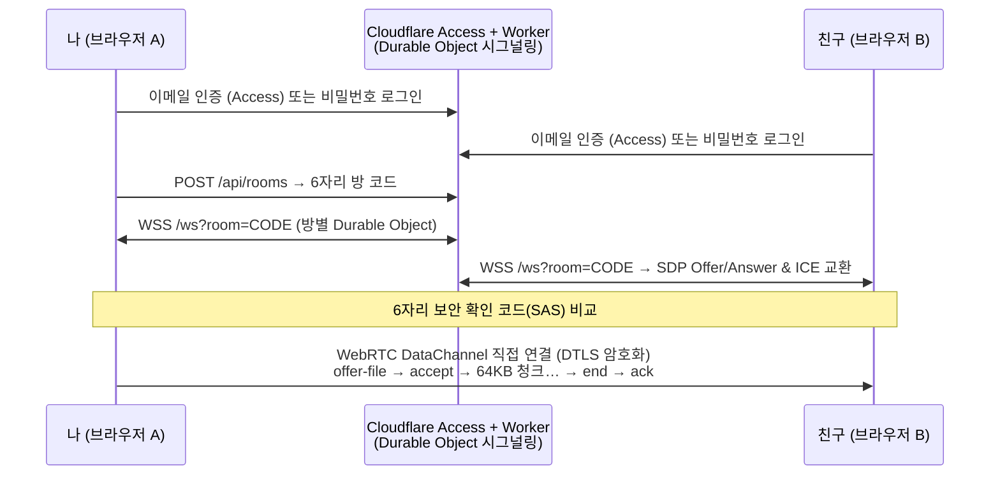

# 📡 P2P File Transfer (Cloudflare Workers + Durable Objects)

친구·가족 등 초대받은 사람끼리 **브라우저에서 직접(WebRTC DataChannel)** 파일을 주고받는 프라이빗 P2P 파일 전송 웹앱입니다.

- **내 PC를 꺼도 24시간 동작** (Cloudflare Workers 무료 플랜)
- **도메인 없이 완전 무료** (`*.workers.dev` + Durable Objects + Cloudflare Access)
- **파일은 서버를 절대 거치지 않음** — Cloudflare에는 웹페이지와 연결 신호(시그널링)만 통과하고, 실제 파일은 브라우저끼리 DTLS 암호화 직통 전송
- **GitHub에 그대로 공개 가능** — 코드에 비밀번호·API 키가 전혀 없고, 배포 시 Cloudflare Secret으로만 주입

---

## 주요 기능

- **직접 P2P 전송 (WebRTC DataChannel)**: 서버 저장소나 업로드 트래픽 비용 없이 브라우저 간 직접 전송
- **대용량 파일 스트리밍**: 64KB 청크 + `bufferedAmountLowThreshold` 백프레셔, Chrome/Edge에서는 **`showSaveFilePicker`**로 메모리에 쌓지 않고 **디스크에 바로 저장**
- **수신 전 수락/거절**: 받는 쪽이 파일명·크기를 보고 **수락**해야 전송 시작
- **이중 보안 옵션**:
  - **Cloudflare Access** (추천): 내 이메일·친구 이메일만 접속 허용 (Worker에서 `Cf-Access-Jwt-Assertion` RS256 서명까지 직접 검증 가능)
  - **비밀번호 로그인 (`APP_PASSWORD`)**: 로컬 개발 또는 Access 없이 쓸 때 사용 (HMAC-SHA256 서명 `HttpOnly` 쿠키 + Durable Object 5회 실패 잠금)
- **보안 확인 코드 (SAS, 6자리 숫자)**: 양쪽 WebRTC DTLS 인증서 지문으로 계산한 6자리 코드를 표시해 시그널링 구간 MITM 여부를 친구와 대조 가능
- **연결 경로 표시**: 직접 연결(P2P)인지 TURN 중계인지 화면에 표시
- **WebSocket Hibernation API**: 유휴 연결 시 Durable Object가 자동 절전되고 `ping/pong`도 자동 응답되어 무료 한도를 거의 쓰지 않음

---

## 동작 구조



---

## 1. 로컬에서 실행 & 테스트

**요구사항**: Node.js 20 이상

```bash
git clone <이-저장소-URL>
cd p2p-file-transfer
npm install
```

1. 로컬 전용 환경 변수 파일을 만듭니다 (`.dev.vars`는 `.gitignore`에 포함되어 GitHub에 올라가지 않습니다).

```powershell
# Windows (PowerShell)
Copy-Item .dev.vars.example .dev.vars

# macOS / Linux
cp .dev.vars.example .dev.vars
```

`.dev.vars`를 열어 `APP_PASSWORD`를 8자 이상으로 설정합니다.

```env
APP_PASSWORD=로컬-테스트용-긴-비밀번호
```

2. 로컬 서버 실행 (`http://127.0.0.1:8787`):

```bash
npm run dev
```

3. 자동 통합 테스트 (실제 `wrangler dev` + Durable Objects 런타임 검증):

```bash
npm test
```

---

## 2. Cloudflare에 무료 배포하기 (내 PC 꺼도 24시간 동작)

> **GitHub 공개와 개인 배포 분리 원리**
> 이 저장소 코드는 그대로 GitHub에 공개해도 안전합니다. 비밀번호나 Access/TURN 키는 코드에 넣지 않고, 아래처럼 **내 Cloudflare 계정의 Secret에만 따로 등록**합니다.

### 1단계. Cloudflare 로그인 및 배포

```bash
npx wrangler login
npm run deploy
```

배포가 끝나면 `https://p2p-file-transfer.<내계정>.workers.dev` 주소가 발급됩니다.

### 2단계. 접근 차단 설정 (둘 중 선택, 또는 둘 다)

#### 방법 A. Cloudflare Access (가장 추천 — 내 이메일 + 친구 이메일만 허용)
1. [Cloudflare 대시보드](https://dash.cloudflare.com) → **Zero Trust** 활성화 (Free 플랜, 50명까지 무료)
2. **Workers & Pages** → `p2p-file-transfer` 선택 → **Settings** → **Domains & Routes** (또는 **Access** 탭)에서 `workers.dev`에 **Cloudflare Access 활성화**
3. 정책에 **내 이메일과 친구 이메일만 Allow** 추가 (이메일 일회용 코드 또는 Google 로그인)
4. *(권장 — Worker 내부 JWT 이중 검증)* Access 앱 설정에서 **Team domain**(`내팀.cloudflareaccess.com`)과 **Application Audience (AUD)** 값을 복사해 Secret으로 등록:
   ```bash
   npx wrangler secret put ACCESS_TEAM_DOMAIN
   npx wrangler secret put ACCESS_AUD
   ```
   이렇게 설정하면 친구가 이메일 인증만 통과하면 별도 비밀번호 입력 없이 바로 입장하며, Worker가 Cloudflare의 RS256 서명까지 직접 검증합니다.

#### 방법 B. 비밀번호 로그인만 사용 (Zero Trust 카드 등록 없이 쓰고 싶을 때)
```bash
npx wrangler secret put APP_PASSWORD
```
8자 이상의 긴 비밀번호를 입력하면 완료됩니다. *(방법 A와 B를 둘 다 설정하면 이메일 인증 + 비밀번호 2중 잠금으로 동작합니다.)*

---

## 3. (선택) 방화벽/LTE 환경용 무료 TURN 서버 붙이기

대부분의 집/와이파이 환경에서는 STUN만으로 직접 연결되지만, 회사 방화벽·대칭형 NAT·모바일 LTE 조합에서는 P2P 직접 연결이 실패할 수 있습니다.

**Cloudflare Realtime TURN (월 1TB 무료)**을 붙이면 자동으로 중계 경로를 잡아 줍니다 (중계 중에도 WebRTC DTLS 암호화는 그대로 유지됩니다).

1. Cloudflare 대시보드 → **Calls / Realtime** → **TURN** → **Create TURN Key**
2. 발급된 Token ID와 API Token을 Secret으로 등록:
   ```bash
   npx wrangler secret put CF_TURN_TOKEN_ID
   npx wrangler secret put CF_TURN_API_TOKEN
   ```

*(직접 운영하는 coturn 서버가 있다면 `TURN_URLS`와 `TURN_SECRET`을 등록해도 됩니다.)*

---

## 환경 변수 / Secret 목록

| 변수 | 위치 | 설명 |
|---|---|---|
| `APP_PASSWORD` | Secret / `.dev.vars` | 비밀번호 로그인용 (8자 이상) |
| `SESSION_SECRET` | Secret (선택) | 세션 쿠키 서명용 별도 비밀키 (미설정 시 `APP_PASSWORD`에서 파생) |
| `ACCESS_TEAM_DOMAIN` | Secret / var | Cloudflare Access 팀 도메인 (예: `myteam.cloudflareaccess.com`) |
| `ACCESS_AUD` | Secret / var | Cloudflare Access Application Audience (AUD) 태그 |
| `ALLOWED_ORIGINS` | var (선택) | 허용할 Origin 목록 (쉼표 구분, 비우면 요청 Host와 일치하는 Origin만 허용) |
| `SESSION_TTL_HOURS` | var (`wrangler.jsonc`) | 비밀번호 로그인 유지 시간 (기본 `12`) |
| `STUN_URLS` | var (`wrangler.jsonc`) | STUN 서버 목록 (기본 `stun:stun.l.google.com:19302`) |
| `CF_TURN_TOKEN_ID`, `CF_TURN_API_TOKEN` | Secret (선택) | Cloudflare Realtime TURN (월 1TB 무료) |
| `TURN_URLS`, `TURN_SECRET` | var / Secret (선택) | 직접 운영 coturn 서버 (HMAC 임시 자격 증명) |

> `APP_PASSWORD`와 `ACCESS_TEAM_DOMAIN`/`ACCESS_AUD`가 **모두 비어 있으면 안전을 위해 503으로 차단**됩니다.

---

## GitHub 공개 전 확인

- `.dev.vars`, `.env`, `.wrangler/`, `node_modules/`는 `.gitignore`에 포함되어 커밋되지 않습니다.
- `wrangler.jsonc`에는 계정 ID나 비밀값이 없으므로 그대로 공개해도 됩니다.
- 푸시 전 `git status`로 `.dev.vars` 같은 로컬 비밀 파일이 포함되지 않았는지 한 번만 확인하세요.

---

## 라이선스

[MIT](./LICENSE)
